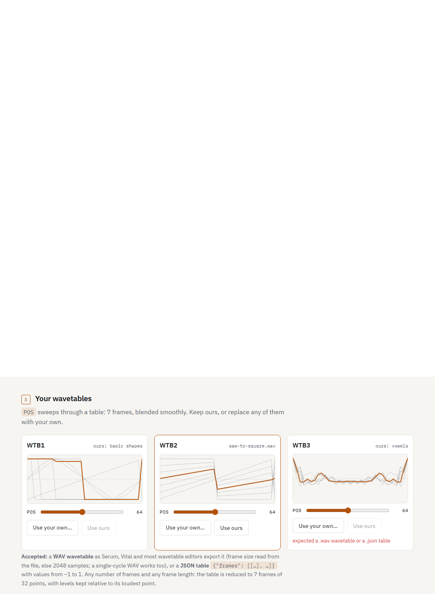
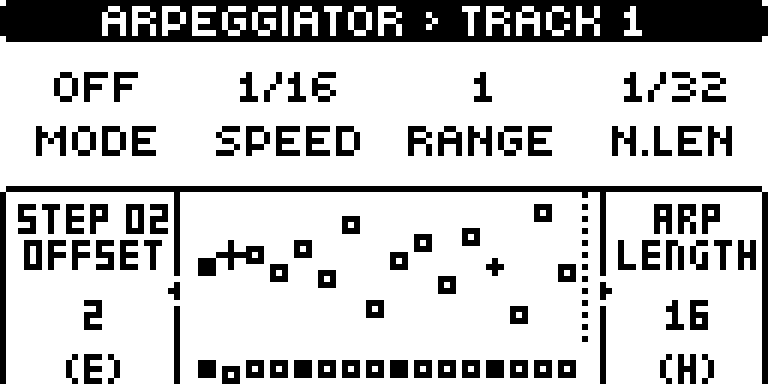

# Firmware mods: the model, and the first one

`dnfw mods` is the user-facing half of this project. Everything else in `docs/`
is how things were found out; this is what someone who owns a Digitone II can
actually do with it.

## What a mod is

A named, declared change to one or more container sections, expressed as bytes
written at known offsets. Deliberately a larger idea than `dnfw.patch`, which
models one same-length edit with `expect` guards — a mod may rewrite hundreds of
kilobytes and carries its own notion of what the user supplies.

Two rules, both enforced rather than remembered:

- **No section's *unpacked content* changes length.** Every address after a
  resized payload moves and nothing here fixes up the code that refers to them.
  A mod needing more room is a code-cave or new-section problem
  (`docs/ideas-backlog.md` §1a, §6).

  **Sharpened 2026-09-14.** This used to read "no section changes length",
  which is wrong in a way that only became visible once a section's *stored*
  length actually changed. The two lengths are different things. The **stored**
  length is the compressed bytes in the container, and the section table records
  where each section sits, so changing it moves nothing an address ever points
  at — `ele3.assemble` rewrites the offsets, and a rebuild re-signs over the
  result. The **unpacked** length is what lands at `dest`, and that is the one
  the code's addresses are relative to. The old wording forbade both.

  This matters beyond pedantry: every replacement of a compressed section
  changes its stored length a little, because compression depends on content.
  Reading the rule as forbidding that would rule out the whole mods system.

  **Sharpened again 2026-09-17, on hardware.** The unpacked length of MAIN OS
  *may* grow — **only by appending past its last byte**, into one shared area.
  Nothing addresses that space, so nothing moves; the boot hook that copies it
  above BSS is the only reader. `intro-bang_DN2_1.11.syx` did exactly that and
  booted on the instrument. The area is a directory of named chunks
  (`scripts/gen_bootscreen_code.py`), so several data-carrying mods can share one
  copy hook instead of each appending their own; merging chunks from two mods is
  the next piece of the compatibility system, and until it exists a mod that
  appends refuses an image that already has an area.
- **Integrity is not the mod's business.** A mod produces section payloads;
  `dnfw build` recomputes the section byte-sum, the content checksum and the
  HMAC-SHA256 trailer, and re-verifies before anything is written.

## Compatibility, and what it does not promise

The goal is mixing mods. That only works if each declares, *before* writing,
which bytes it will touch — so every mod implements `extents()` and
`check_compatible()` compares every pair.

**Byte-range overlap is the whole test.** Two mods writing disjoint bytes can
still fight over the same feature, and nothing here detects that. It is the
weakest useful guarantee; it is enforced because it is the part that is
checkable, and the limit is written down rather than glossed.

Every pair is compared, not each against the last: "A is fine with B" and "B is
fine with C" says nothing about A and C.

**A real check is filed as `docs/ideas-backlog.md` §11**, to be built when two
mods first share a section or a processor. Until then the two that exist cannot
collide — `moddest` writes ColdFire data in section 3, `transients` writes SHARC
data in section 7 — so the overlap test returns the right answer and would
return the right answer if it did nothing at all. That is worth knowing about a
check before trusting it.

**Superseded 2026-09-26: the check now bites, and it is run on every pair.**
Eight mods exist, six of them in section 3, and `dnfw mods matrix` tries every
pair in both orders (`docs/mods-compatibility.md`, generated). It found:
- three real overlaps: two mods in one cave, and three appending mods on one
  start-up hook;
- one pair that combines only in one order;
- one trap that byte overlap cannot see. A mod that copies part of the image
  (lfo4 copies the parameter table) silently loses a later mod's edit to that
  part, so mods now declare what they copy (`COPIES`).

## Mod 1: `transients`

Replaces the FM drum transient bank (`docs/pcm-hunt.md` §14).

| | |
|---|---|
| section | 7, the SHARC image |
| bank | DDR `0x8045b000`–`0x804ac000`, bounded by float32 tables either side |
| entries | **34**, each 4,800 samples = exactly 100.0 ms at 48 kHz, 16-bit mono LE |
| phase | 2,496 samples into the region |

The load address is mapped to a file offset by walking the boot stream for the
block that covers it — the payloads are scattered across L1, L2 and DDR, so an
offset into the section is not an address, and writing to the wrong one would
corrupt an unrelated region.

### What validates it

**Extracting the factory bank and writing it straight back produces a
byte-identical section 7.** That is a strong check rather than a pleasant one:
a wrong offset, entry size, count, endianness or sample width would each corrupt
bytes, and none does. Rebuilds pass 21 of 21 integrity checks.

### CONFIRMED ON HARDWARE — 2026-09-14

An image carrying marker samples at five known slots
(`scripts/make_marker_transients.py`) was flashed to a Digitone II, and **every
marker played back from `TRAN`.**

That closes both questions this section previously listed as open:

| was open | now |
|---|---|
| never flashed — a file transformation, not a proven firmware change | **flashed and heard** |
| not traced from `TRAN` (id 286) to these bytes | **`TRAN` plays them** — an empirical trace, which is the stronger kind |

It validates the whole chain in one step: locate a bank by statistics, map its
load address to a file offset through the boot stream, replace entries, rebuild,
re-sign, flash, hear. No part of that sequence was previously known to work end
to end.

### What the flashed image actually differs by

Measured 2026-09-14 by rebuilding the marker image and diffing it against stock
1.11, on unpacked content:

| id | name | unpacked | result |
|---|---|---|---|
| 5 | meta | 15 | identical |
| 2 | bootstrap | 30,302 | identical |
| 3 | MAIN OS | 3,192,192 | **identical** |
| 4 | updater | 32,768 | identical |
| 7 | blob (SHARC) | 836,956 | 47,529 bytes differ, offsets 497,108..823,506 |
| 8 | ? | 159,948 | identical |

The bank runs from section-7 offset 497,108 to 823,508, so the diff stops two
bytes inside its end: **the mod wrote nothing outside the bank.** 47,529 bytes
is right for five replaced entries of 34 — 5 × 9,600 = 48,000 less the bytes
that coincide, mostly zeros.

This was measured to answer a question from the `DNX` session, which read all
16 patterns of bank A as **storage version 4** over the dump protocol while
+Drive project files from the same OS decode as version 3, and could not tell
whether that was 1.11 or our build. It is not ours: every storage-format
decision lives in MAIN OS, and MAIN OS is byte-identical. One hypothesis
eliminated by measurement rather than by argument.

Worth keeping for its own sake too: it is the evidence that **a mod's declared
extents match what it actually writes.** `extents()` is the whole basis of mod
compatibility, and until this it was a promise the code made about itself.

**What stays conditional:** the bank's location, format, entry length and count
are *measured*, not documented by Elektron, so another OS release could move
them. The mod resolves the address through the boot stream at apply time and
refuses an image whose layout it does not recognise, rather than trusting a
constant.

### The count, resolved

`docs/pcm-hunt.md` §14 recorded a disagreement: the measured extent gives 34
entries, while `TRAN` spanning 0..124 with 4-step interpolation implies 32.

**34 is right.** The owner auditioned the cut bank and entries 32 and 33 are
both good transients. So the interpolation model's step count or mapping is
wrong, not the measurement — and the mapping from `TRAN`'s 125 positions onto 34
entries is still unknown.

## Mod 3: `bootscreen`

The start-up animation: a user-supplied 128×64 mark written into the intro's
source bitmap every frame, static or flashing, and the tunnel's texture scale.
All choices are data in a `BOOT` chunk of the appended area; the 200 bytes of
code are assembled once into `src/dnfw/mods/bootscreen_code.json` and shared with
the site. `src/dnfw/mods/bootscreen.py` carries the evidence.

    dnfw mods apply <image> --mod bootscreen --boot-image mark.pgm --boot-invert         --boot-slow 4 --boot-fast 3 --boot-rush 48 --boot-stop 72 --tunnel 128 64 -o out.syx

Built through this command, it behaves identically to the hand-built
`intro-bang` that passed on hardware: filmed under the emulator from the same
snapshot, every frame whose intro frame number matches is byte-identical — the
only differences are slices that land on a different frame, because the
directory lookup spends a few more instructions per frame.

## Adding a mod

Implement in `src/dnfw/mods/<id>.py`: `ID`, `NAME`, `SUMMARY`, `DEVICE`,
`SECTION`, `extents(firmware)`, and `apply(firmware, ...) -> Result`. Register it
in `src/dnfw/cli/mods.py`'s `REGISTRY`. Declare extents honestly — a mod that
under-declares breaks the only compatibility guarantee the system offers.

## The site

`site/index.html`, published to GitHub Pages by `.github/workflows/pages.yml`.

It lives in `site/` rather than `docs/` on purpose: `docs/` is the research
record, and Pages would turn ~40 files of measurements and retractions into
public pages. The site is a small front door that points back here for detail.

---

## The browser tool

**Status: built, and live at `site/transients.html`.** The page loads a real
`.syx`, derives its signing key, depacks and repacks section 7, replaces any of
the 34 transients with the user's own audio, reassembles the container,
re-signs, re-verifies, and offers the result for download — and the image it
produces is **byte-identical to the one the Python tool builds**, and 4,608
bytes **smaller** than stock 1.11.

What remains untested is the page's *layout* — the logic behind it is checked
against real firmware in `test/test_js_{codec,firmware,mod}.py`, but nobody has
looked at it in a browser yet.

**The requirement, from the owner: zero CLI, zero cloning.** A user opens a web
page, picks their own firmware file and their own samples, adjusts each one,
hears the result, and downloads a firmware image. Everything client-side —
GitHub Pages is static, and nothing should be uploaded anywhere, which is also
what `transientsplit` does and the right posture for someone's firmware.

### What the browser has to do

| step | difficulty | state |
|---|---|---|
| SysEx transport decode/encode (8-in-7) | easy | **done** — `syx/` |
| ELE3 container parse and rebuild | moderate | **done** — `container/` |
| aPLib **depack** of section 7 | moderate — port of `codec/aplib.py` | **done** |
| aPLib **pack** of section 7 | was **the blocker** | **done** — full parse port, plus a store-only fallback |
| content checksum + HMAC-SHA256 | easy, `SubtleCrypto` | **done** — `integrity/` |
| the transients mod itself | moderate — bank offset through the boot stream | **done** — `mods/transients.js`, `bootstream.js` |
| audio decode, fit, preview | easy, Web Audio | **done** — `audio.js` |
| the UI | — | **done** — `transients.html`, not yet seen in a browser |
| transient/tonal separation | **not ours** — link to `transientsplit` | n/a |

`site/js/` mirrors `src/dnfw/`'s module layout deliberately — `syx/`,
`container/`, `integrity/`, `mods/`, `aplib.js` and `aplibpack.js` split the
same way the Python is, and one `firmware.js` for the order they go in. Two
implementations that drift are a liability; two that sit side by side with the
same names make the drift visible.

### The decision on packing: store-only first, then the real packer

**[SUPERSEDED 2026-09-14 — store-only shipped, then was replaced. Kept because
the reasoning that led to it was sound and the failure was in what it left
unmeasured.]**

The original decision was a literal-only encoder. Only section 7 is modified,
so sections 2, 3 and 8 keep their original stored bytes and never need
repacking; that reduces the problem to one section, and a store-only stream is
the easiest kind of aPLib stream to be sure of — one token type and the
terminator, no offsets, no lengths, no reuse state. Porting the real packer was
called "the blocker" and routed around.

It worked, and it cost this:

```
section 7:  602,076 stored  ->  836,956 unpacked  ->  941,583 store-only
.syx:     2,389,280  ->  2,819,488   (+430,208)
```

**What was wrong with it was not the size. It was that the size was never
compared against anything.** 340 KB was written down as a cost and filed as
acceptable, next to a note that the device had never been given a larger
section 7. Those two facts belonged together and were not put together.

The owner put them together: the transient entries are fixed-size slots
replaced in place, so why does anything grow? It doesn't. The **unpacked**
section is 836,956 bytes whatever you put in it. Only the compressed size
moves, and only because compression finds redundancy and how much is there
depends on the audio. Measured on 1.11 section 7:

| content | stored | `.syx` | vs stock |
|---|---|---|---|
| stock | 602,076 | 2,389,280 | — |
| **markers — the image flashed 2026-09-14** | 564,196 | 2,341,280 | **−48,000** |
| 34 realistic decaying drum hits | 576,364 | 2,356,640 | **−32,640** |
| 34 slots of white noise (worst case) | 653,852 | 2,454,816 | +65,536 |
| store-only | 941,583 | 2,819,488 | **+430,208** |

So the real packer stays within ±64 KB and is *smaller* for anything musical —
and **the image confirmed on hardware was 48,000 bytes smaller than stock.** It
never tested a larger image because it never was one. Store-only bought a day
of work and paid for it with an untested hardware condition on the one path a
user would actually take.

**`site/js/aplibpack.js` is now a full port** of `codec/aplibpack.py`'s parse —
greedy with one-position lazy lookahead over a 2-byte hash chain, decided by
`compress.c`'s cost model, bounded by `codec.limits`. Measured on DN2 1.11:

| section | raw | JS packed | Elektron | vs stock | JS time | Python time |
|---|---|---|---|---|---|---|
| 2 bootstrap | 30,302 | 16,138 | 16,166 | −28 | 9 ms | 0.2 s |
| 3 MAIN OS | 3,192,192 | 1,129,103 | 1,130,517 | −1,414 | 629 ms | 25.9 s |
| 7 blob | 836,956 | 598,410 | 602,067 | −3,657 | 177 ms | 8.8 s |
| 8 | 159,948 | 102,552 | 103,407 | −855 | 27 ms | 1.2 s |

Every section comes out smaller than Elektron's own, and a full browser rebuild
of 1.11 is **2,384,672 bytes — 4,608 smaller than stock.** The size risk is
gone rather than documented.

**`packStore` is kept** as the fallback whose correctness can be argued in a
sentence, and as the control `pack` is measured against. It is not dead code:
`test_js_codec.py` asserts it still emits no matches, because that is what
makes it the simple thing.

The lesson is not "store-only was a bad idea". It was a reasonable first move.
The failure was writing down a number that differed from every image the device
had ever accepted, and not asking what that difference cost.

### How it was verified, which is the part that matters

A second implementation of a format that writes firmware people flash is a real
correctness risk, so it does not get trusted because it looks right. These
checks were written down **before any of the code existed**, and all now run in
`test/test_js_codec.py` against real firmware — `scripts/js_codec_check.mjs` is
the JS half.

| # | check | result |
|---|---|---|
| 1 | **Depack agreement** — JS depack of every compressed section == Python's | **pass**, byte for byte |
| 2 | **Self round-trip** — JS depack of JS `pack` and `packStore` output == input | **pass** |
| 3 | **Cross-check** — JS output depacked by `codec/aplib.py` | **pass**, 836,956 bytes identical |
| 4 | **Whole-image rebuild** — section 7 repacked, container reassembled | **pass, 21/21 integrity checks** |
| 5 | **Packer agreement** — JS `pack` output == Python `pack` output | **pass**, byte-identical on all four compressed sections |
| 6 | **Size** — every section at or under Elektron's own stored length | **pass**, all four smaller |
| 7 | **Limits** — no offset past `PACK_MAX_OFFSET`, no match over `MAX_MATCH` | **pass** |

**Check 5 is the sharpest thing in this file.** A packer has enormous freedom —
any parse that round-trips is correct — so "it round-trips" leaves most of the
implementation untested. Demanding the *same bytes* as `codec/aplibpack.py`
pins the cost model, the tie-breaking between equally long matches, the
lazy-lookahead arithmetic, the offset window, the chain depth, and the exact
point in the loop where the hash chain is updated. Any one of those differing
shows up immediately.

That is only a fair demand because the JS packer is a deliberate port of that
parse. Where the two implementations are meant to be *independent* — the
depacker, the container, the transport — the standard is agreement on content,
not on bytes, and checks 1, 3 and 4 are written that way.

Check 4 is not a codec check at all: it asks whether the container still adds
up when a section changes stored length. It does, and the trailer and content
checksum re-sign correctly over the result.

Check 7 is the one that matters for the device rather than for correctness. A
stream can checksum perfectly and still reach further back or copy longer than
anything Elektron ship, and images of ours that did exactly that **stalled in
the Early Start-up Menu's recovery flash**. It is the failure this project has
actually hit, so it is asserted rather than reasoned about.

### The stack above the codec, and its two harder checks

`test/test_js_firmware.py`, over the whole pipeline:

| check | result |
|---|---|
| **Round-trip** — load a real image, build it straight back, nothing replaced | **byte-identical** |
| Signing key recovered from the image's own material | **pass**, derived from `"Multiplier"` |
| Every integrity field on the original | **9/9** |
| Repacked rebuild reloads, re-verifies, section content unchanged | **9/9** |
| **JS-built image vs Python-built image, same input** | **byte-identical** |
| Full browser rebuild of 1.11 | **2,384,672 bytes — 4,608 smaller than stock** |

The round-trip is `docs/ROADMAP.md`'s **Gate A in JavaScript**: one comparison
exercises SysEx framing, 8-in-7, per-packet checksums, marker counters, the
container layout, the content checksum and the HMAC trailer at once, and any one
of them being wrong shows up as a differing byte.

The last row is the one that would catch a shared *assumption* rather than a
coding slip — the failure mode where both implementations are wrong in the same
direction, which no amount of self-checking can find.

**The key never leaves the browser, and is never stored.** It is derived from
the user's own firmware file in their own tab, the way `integrity/keyderive.py`
does it, and a candidate is only accepted when it reproduces that image's own
trailer — so a wrong guess cannot pass as the right one.

**What none of this proves: that the device accepts an image this toolchain
built.** Every check above is offline.

The size question that was open here is **closed**: the browser now emits an
image 4,608 bytes smaller than stock, and every section packs smaller than
Elektron's own, so nothing about these images is larger than what the device
already accepts. The store-only route would have put a 340 KB-larger image in
front of a recovery bootloader, and that risk is gone rather than documented.

What is still untested is narrower and honest: **no image built by the
JavaScript path has been flashed.** The Python path has been, repeatedly, and
the two produce byte-identical output on every input tried — which is strong,
but it is an inference, not a flash. The first hardware run of a
browser-produced image should be treated as a first run.

## Mod 4: `lfowaves` — seven LFO waveforms, swappable wavetables

`src/dnfw/mods/lfowaves.py`, `site/js/mods/lfowaves.js`, page `site/lfo.html`.
STEP PULS NOIS TRAP WTB1 WTB2 WTB3 after RAND, each with its own glyph and a
renamed SPH (STPS WDTH TYPE SLOP POS). Passed on hardware 2026-09-17 as
`lfo-waves` / `lfo-waves2`.

- **Pre-assembled.** `scripts/gen_lfo_waves_code.py` runs
  `build_lfo_waves.compose` and writes `lfowaves_code.json` / `lfowaves-code.js`:
  33 guarded edits (stock bytes checked before writing), a 2,684-byte blob with
  every stock-derived range blanked (six `fills` read from the user's own image),
  and the three table offsets. No reassembly is needed to change a table: the
  generators and the glyph renderer read the tables at run time.
- **Wavetable input** (`src/dnfw/wavetable.py`, `site/js/wavetable.js`, same
  algorithm): a WAV wavetable — Serum/Vital style, frame size from a `clm `
  chunk, else 2048, else one cycle; PCM 8/16/24/32 or float 32/64; first channel —
  or a JSON `{"frames": [[...]]}`. Reduced to 7 frames (linear along the table),
  32 points each (box average), scaled so the loudest point is 127.
- **CLI:** `dnfw mods apply firmware.syx --mod lfowaves --wavetable 2=table.wav -o out.syx`.
- **Parity:** `node scripts/js_lfowaves_check.mjs` — WAV → identical 224 bytes,
  MAIN OS identical to the Python mod, rebuilt image 21/21; a float-32 stereo
  single-cycle WAV also reduces identically. The Python mod equals
  `build_lfo_waves.compose` with the same tables.
- **Page, driven headless in Chrome** (the harness drops the stock `.syx` and a
  WAV, clicks Build): seven waves listed, the WAV lands in WTB2, a junk file
  explains itself, build verifies 21/21 and offers the download.



**Conflicts:** claims the startup hook and grows MAIN OS through the appended
area, as the boot-screen mod does — `check_compatible` reports it; they are
alternatives until a shared area registry exists.


---

## Mod 5: `midiarp` -- the arpeggiator on MIDI tracks

The mod's own docstring (`src/dnfw/mods/midiarp.py`) and `docs/ideas-backlog.md`
section 10 carry the design and the hardware pass of 2026-09-17. What changed on
2026-10-03 (reported by the contributor of PR #176, checked in the emulator by
`scripts/emu_midiarp_layered.py`, not yet flashed):

- **Layered copies.** TRACK WILL TRIGGER copies a note record onto the destination
  track in the frame ISR (`+56` bit 17). midiarp used to turn that copy into a MIDI
  note from the record's inline fields, which a sequencer trig never fills: random
  notes. Now a layered copy on a MIDI track plays only as that track's own arp note
  (the arp on, and the ISR's arp step made it); with the arp off it is left to stock
  and stays silent. A note is read from the ISR's entry, which is the inline entry for
  an arp step.
- **The MIDI record pool.** The allocator pops its free list without an empty check;
  the hook takes a record only while four are free and drops the note otherwise.
- **The platform.** Its code is a 592 B `CODE` chunk at `0x467d0000`, not a cave
  shared with usbprobe: `midiarp` combines with every mod, so a build can carry the
  USB probe too (`dnfw mods apply --mod midiarp --mod usbprobe`).

## Mod 6: `fxmod` — an LFO on the Chorus, Delay and Reverb

**Status: shipped, confirmed on hardware 2026-09-23, live at `site/fx.html`.**

Stock firmware offers an LFO a hundred destinations and every one is inside the
voice. The machine's global effects are not among them, and *three separate
things* keep them out: the `DEST` list never enumerates them, the evaluator's
bound stops at 100, and the code that turns a list entry into a stored `DEST`
value has no way to spell one. Opening any one of the three on its own changes
nothing visible, which is why this mod is bigger than `moddest` and why
`moddest`'s page says the effects "stay closed" — that page was right about the
mask and wrong to imply the gate could not be opened another way. Both pages now
say so.

`docs/fx-master-modulation.md` is the evidence: §12 the engine half, §15 and
§18 the browser half and the counting error that cost a second flash, §23 the
group-name fix.

- **What changes:** 23 places in section 3, 179 bytes, nothing appended and no
  length changed — two bounds, two hooks into a 128-byte code cave, seven `jsr`
  targets, ten records' `+44`, and one name pointer.
- **Generator** (`scripts/gen_fxmod_code.py`): runs
  `build_fxbrowser.compose` — with `build_fxbrowser2`'s four extra conversion
  sites and `build_fxbrowser3`'s longword — and writes `fxmod_code.json` /
  `fxmod-code.js`: every changed run with the stock bytes it expects, plus **26
  guards**, sites the mod reads and reasons from but never writes. The cave is
  one edit whose stock guard is the whole free run, so an image with something
  already there is refused.
- **The strong check:** `dnfw mods apply … --mod fxmod` produces a `.syx` whose
  sha256 is **identical** to `fxbrowser3_DN2_1.11.syx`, the gated build whose
  predecessor was flashed. `test_fxmod_mod.py` asserts that byte equality, so
  this mod is not a re-derivation of the build for users — it *is* the build.
- **CLI:** `dnfw mods apply firmware.syx --mod fxmod -o modded.syx`.
- **Parity:** `node scripts/js_fxmod_check.mjs` — MAIN OS identical to the
  Python mod, rebuilt image 21/21, and the group-name longword reads `CHR`
  afterwards where it read `ERR` before with Reverb's and Delay's untouched.
  Run by `test_js_fxmod.py`, which fails if the harness produces no checks at
  all rather than reading an empty run as a pass.
- **Page, driven in Chrome** (the stock `.syx` uploaded, Build clicked): the 24
  destinations render in three labelled groups — Chorus 7, Delay 9, Reverb 8 —
  the load verifies 21/21, the rebuild verifies 21/21 and offers
  `Digitone_II_OS1.11_fxmod.syx` at 2,387,616 bytes, with no console errors.

**Conflicts:** ~~none known~~. **Corrected 2026-09-26:** it shares a code cave
with `arpplocks` (`0x4028ea04`, 126 bytes). `dnfw mods matrix` refuses the pair,
and so does `apply`. It writes inside section 3 only, appends nothing and claims
no startup hook, so `check_compatible` clears it against `moddest`, `lfowaves`,
`midiarp` and `transients`. Against `lfo4` it is order-only, and refuses an lfo4 image (2026-09-26): its Chorus record
edits must be in the table before lfo4 copies it. As always that is a byte-overlap
statement and not a musical one, and no combined image has been flashed.

**What it deliberately leaves out.** Master. Its slots need destination codes
136..145 and the firmware widens a `DEST` byte with `mvs.b`, which makes
anything above 127 negative. That is a different edit and it is not in here.

**What a user should know before flashing.** These are the machine's *one*
Chorus, Delay and Reverb. Sixteen tracks' LFOs can all aim at the same cell and
they add up, because every evaluator reads the cell and adds to it before the
clamp. That is what "global" means, not a fault — but it is surprising the first
time, so both the page and the index card say it.

## Mod 8: `lfo4` -- a fourth LFO

The fourth `[MOD]` page. It modulates on every voice, and is kept by SAVE
PROJECT and across a power-cycle without one (`docs/lfo4-build-plan.md`, tests
10 and 11). Unlike every mod before it, it is **C**: `csrc/lfo4/`, compiled and
linked by `scripts/build_lfo4_browser.py`.

**How C becomes a mod.** The C stays the source. `scripts/gen_lfo4_code.py`
runs the release build's own composition (`build_lfo4_browser.RELEASE`) and
records what it changed as data (`src/dnfw/mods/lfo4_code.json`):
- 209 in-image edits, each with the stock bytes it expects;
- the 23,732-byte appended area.

It then applies the result to stock and refuses to write unless the output is
byte-identical to the build. `dnfw mods apply --mod lfo4` on stock 1.11 writes
**the same `.syx`, byte for byte**, as `lfo4-fast`. Until 2026-09-27 that was
`lfo4-everyvoice4`, the release twin of the code that passed on the instrument;
`lfo4-fast` is the same code with an idle LFO4 costing the frame nothing and
cheap `memcpy`/`memset` stubs, after the owner bisected a save-while-playing
stutter to lfo4 (`docs/lfo4-build-plan.md`, "Idle costs nothing").

**No stock data ships.** The appended area carries a copy of the parameter
table, 320 stock records plus ten for LFO4 derived from LFO3's. Those 19,800
bytes are blank in the JSON and rebuilt at apply time from the user's own image
(`paramtable.records`, `lfo4records.build`).

**Order matters, and the CLI enforces it.** Because lfo4 copies the table,
`APPLY_LAST` puts it after every other mod. So `moddest`'s thirteen masks and
`fxmod`'s Chorus records are in the copy (tested). Since 2026-09-30 the start-up
loader and the appended area are the platform's (`src/dnfw/mods/platform.py`), and
lfo4 adds its two `CODE` chunks to them, so it combines with `lfowaves` (applied
first) and `bootscreen` (`docs/mods-compatibility.md`).

**Browser:** `site/lfo4.html`, 2026-09-26. `gen_lfo4_code.py` also writes
`site/js/mods/lfo4-code.js` from the same data (the JSON stays byte-identical, and
the script still reproduces the release build byte for byte), and
`site/js/mods/lfo4.js` ports `compose`: the stock length and every edit's stock
bytes are checked, with the Python's wording, then the relocated table is rebuilt
from the user's image (`paramtable.records`, `lfo4records.build` with
`free_unique_ids` and the five field rewrites), so no table bytes ship to the
browser either.
- **Order in the browser.** One page, one mod: the user builds fxmod or moddest
  first and loads that download into the LFO4 page, which says so. The pages
  that must come first refuse an lfo4 image: moddest already did, and fxmod now
  checks the table's 56 accessor bases (`paramtable.base_sites`, ported as
  `fxmod.tableInPlace`) and says to apply fxmod first, in the CLI and the browser.
  Without that, fxmod after lfo4 applied cleanly and opened ten records in a
  table nothing reads.
- **Parity:** `node scripts/js_lfo4_check.mjs`, run by `test_js_lfo4.py`: stock
  -> lfo4 equals `lfo4.compose`; fxmod -> rebuilt `.syx` -> reloaded -> lfo4
  equals MAIN OS of the CLI's `--mod fxmod --mod lfo4`; moddest -> lfo4 equals
  the Python's; lfo4 accepts a midiarp image; every rebuilt image verifies 21/21;
  and five refusals (lfo4 on an lfowaves image, on a longer image, on an edited
  site; fxmod and moddest on an lfo4 image) are worded the same on both sides.
- **Page, driven in Chrome** (the stock `.syx` uploaded, Build clicked): the load
  verifies 21/21, the eight controls render, the rebuild verifies 21/21 and offers
  `Digitone_II_OS1.11_lfo4.syx` at 2,398,112 bytes, **SHA-256-identical to the
  CLI's `--mod lfo4` output**, with no console errors. An lfowaves image is
  refused on its length; the FX page refuses the lfo4 image and names the order.

## Mod 9: `arpmodes` -- SHUF and RAND, as real arp modes

**Status: confirmed on the instrument 2026-09-26** (`arpmodes_DN2_1.11.syx`; the owner: *"works in device"*). ~~Built and emulator-gated 2026-09-26; not yet on the instrument.~~

Stock 1.11 names eight arp modes and offers five. SHUF, RAND and CHRD have no
code behind them, and all three play CYCL (`docs/arp-hidden-modes.md`). This mod
gives SHUF and RAND their own code and widens the MODE menu to them. CHRD (7)
stays out, at the owner's decision. The menu stops at RAND, and a 7 forced in
some other way still plays CYCL.

- **SHUF** plays every note of the range once per cycle, in a new random order
  each cycle. The range is the held notes times RNG + 1 octaves. The note that
  ends one cycle never starts the next.
- **RAND** plays a random note of the range on each step. Repeats are allowed.
- **Everything else is the stock step.** The new code only picks a note and an
  octave, then hands them to the step's own tail (`0x4002a376`), as UP does. So
  LEN, the step mask (a muted step rests and does not advance), the step
  offsets, SPD and N.LEN behave as in every other mode.

**What changes:** 8 edits in section 3, 374 bytes. Nothing is appended and no
length changes.
- The dispatch at `0x4002a13c`: 12 bytes become a `jmp` to the cave. The cave
  sends 3 to DOWN, 5 and 6 to the new code, and everything else to CYCL.
- The five `moveq #4` MODE bounds become `moveq #6`: setMode (`0x4004befa`,
  `0x4004bf00`), the FUNC+ARP restore (`0x4004bfb4`, `0x4004bfc6`) and the
  stored-sound LOAD (`0x400dd530`).
- Two code caves: 230 B at `0x402d08c0` and 122 B at `0x4028fcb4`. The first is
  the free tail of the run that midiarp and arpplocks ran from on the instrument
  (both have since moved to the platform).
- RAM: 2,320 B at `0x467a0000`, above BSS. It holds the generator and one
  144-byte SHUF record per track (which entries this cycle has played).

**Randomness.** A private xorshift32, one generator for all tracks. The
firmware's shared `rand()` (state `0x405cd95c`) is not called or touched. When
an arp starts on SHUF or RAND, the millisecond tick (`0x466758b0`) is XORed into
the generator, so boots and chords do not replay one sequence.
`scripts/build_arpmodes.py` has the design and the RAM layout.

**Generator:** `scripts/gen_arpmodes_code.py` composes `build_arpmodes.compose`
on stock and writes `arpmodes_code.json`: every edit with the stock bytes it
expects, plus 15 guards. It refuses to write unless the JSON, replayed on
stock, is the build byte for byte. `test_arpmodes_mod.py` checks the same
against `out/arpmodes/section_3_MAIN_OS.bin`.

**A sound saved with SHUF or RAND** is stored as MODE 5 or 6. Stock firmware,
or any build without this mod, loads it with its arp **OFF**, because stock's
LOAD bound turns anything above 4 into 0. That was measured on stock, not
assumed.

**With arpplocks.** arpplocks' MODE lock used to clamp to its own 0..4. It now
takes its ceiling from the immediate of setMode's clamp (`0x4004bf01`), so it
follows whatever the menu reaches: CYCL on its own, RAND with this mod. This is
a **patch to arpplocks**, not an order rule or a declared conflict: 10 bytes in
arpplocks' UI cave. The two write disjoint bytes and apply in either order, and
neither names the other. Measured in the emulator, with arpplocks alone as the
control.

**Gates** (2026-09-26): `scripts/emu_arp_modes.py` (stock, the mod, arpplocks
alone, both), `scripts/emu_boot_check.py`, `scripts/emu_boot_engine.py
--arp-mode`, `scripts/check_coldfire.py`, and a push-and-turn screenshot of the
MODE menu. The results are in `docs/arp-hidden-modes.md` §7.

**Browser:** `site/arp-modes.html`, 2026-09-26. `gen_arpmodes_code.py` also
writes `site/js/mods/arpmodes-code.js` from the same data (the JSON stays
byte-identical, and the script still replays to the build byte for byte), and
`site/js/mods/arpmodes.js` ports `apply`: the stock length, the 15 guards and
every edit's stock bytes are checked with the Python's wording, then the 8 edits
are written. arpplocks has no browser page, so its MODE-lock patch has no JS copy
to keep in step.
- **Parity:** `node scripts/js_arpmodes_check.mjs`, run by `test_js_arpmodes.py`:
  stock -> arpmodes, midiarp -> rebuilt `.syx` -> reloaded -> arpmodes, and lfo4
  -> rebuilt -> reloaded -> arpmodes each equal the CLI's `dnfw mods apply`
  output, MAIN OS and the whole `.syx`; every rebuilt image verifies 21/21;
  midiarp and lfo4 still apply after it; three refusals (applied twice, a
  shorter image, an edited guard) are worded the same on both sides.

**Combines** with every other mod: `dnfw mods matrix` gives `yes` for all eight
pairs. As always, that is a statement about bytes. With `midiarp`, a MIDI
track's arp runs the same step, so SHUF and RAND should reach MIDI tracks too.
That has not been run.

## Mod: `arpscale` (arp offsets in scale)

**Status: confirmed on hardware** (2026-10-14, the repository owner's Digitone II, `arpscale-pr212_DN2_1.11.syx`, the same bytes as `arpscale3`: the written hardware test below passes). By [w-winter](https://github.com/w-winter) (pull request #212). Their own reports are in `docs/flashing.md`. On this build (`arpscale3_DN2_1.11.syx`, the code at `0x467a8000`), the item appears and toggles, notes from trigs and notes held live on the KEYBOARD page move in scale, and the setting survives a power cycle. Earlier builds placed the code at `0x467e8000`: the first moved only notes from trigs, and the rebuild that also moves notes held live worked, as did the arp's RANGE above 0. The emulator checks below are on this build. Steps in semitones (version 0.2.0) is not yet tested by the repository owner. On w-winter's Digitone II (`arpscale4_DN2_1.11.syx`, an external report in `docs/flashing.md`), its written hardware test below passes, and the rotate, a copy and paste, and the paste's undo keep the marks with their steps. The current build, `arpscale5_DN2_1.11.syx`, differs from `arpscale4` in one branch: with ARP OFS IN SCALE off, `[UP]` and `[DOWN]` leave the marks as they are (`arpscale4` dropped a step's mark there).

Stock 1.11 adds each arp step's OFFSET in semitones, after KEYBOARD SETUP's SCALE and ROOT have chosen the held notes, so an offset leaves the scale: in C major, E plus 2 plays F#. This mod adds **SETTINGS > PERSONALIZE > ARP OFS IN SCALE**. Off, the default and what a fresh instrument reads, the arp is stock. On, an offset counts degrees of the track's scale from its root: in C major, E plus 2 plays G, and plus 7 plays the octave above.


- An offset of 0 plays the held note unchanged, even a note outside the scale.
- A held note outside the scale moves to the nearest scale note first (the lower one on a tie, the firmware's own order), then by degrees.
- A scale's octave is its length in degrees: 7 in a major scale, 5 in a pentatonic one, 6 in whole tone.
- RANGE still adds whole octaves. SCALE CHROMATIC and MODE CHORD MEMORY keep stock's offsets in semitones.
- SCALE and ROOT come from the playing pattern, per track or per pattern as KEYBOARD SETUP's CONFIG says, for notes from trigs and for notes held live on the KEYBOARD page, with the sequencer playing or stopped.

**Steps in semitones.** With ARP OFS IN SCALE on, a step can be marked to move in semitones, for a note outside the scale in an otherwise in-scale sequence. In the ARPEGGIATOR menu, select a step with `[LEFT]`/`[RIGHT]` and press `[UP]` on it while it is active: the step graph draws a plus for it in place of its square. `[DOWN]` removes the mark, and `[DOWN]` again mutes the step, as in stock. With ARP OFS IN SCALE on, unmuting a step gives an unmarked one. With ARP OFS IN SCALE off, every step moves in semitones, marked or not, and the menu works and looks as in stock: `[UP]` and `[DOWN]` mute and unmute, and leave the marks as they are.



The marks belong to the sound, as its offsets do. They are saved with it and follow it through copies of the sound, the kit and the pattern, and the ARPEGGIATOR menu's rotate (`[FUNC]` + `[LEFT]`/`[RIGHT]`), copy, paste and clear move them with the steps; repeating a paste or a clear undoes it, marks included. A sound with marks is expected to load on stock firmware as it would without them, and stock's next save of it is expected to drop them, because stock's load never reads the marks' two stored bytes and its save zeroes them. Neither has been tested.

**What changes:** twelve edits in section 3 and a platform `CODE` chunk.
- `0x4002a390`, the arp step's common tail, where every mode adds the octave and the offset: 6 bytes become `jmp arp`. arpmodes' SHUF and RAND enter the same tail, so they pass through it.
- `0x40098630`, PERSONALIZE's constructor after its last stock item: 6 bytes become `jmp menu_hook`, which replays them and appends the item. reloadconfirm hooks the constructor's epilogue, so with both, RELOAD CONFIRM follows this item. Both build their item from `scripts/build_personalize_toggle.py`, each into its own chunk.
- Steps in semitones: the marks are 16 bits per sound, bit n for step n. In RAM they are the sound's value slot 100 (`+0xdc`): no parameter is filed at slot 100 (`docs/parameter-set-tables.md` section 6), stock's copies of a whole sound carry it, and initializing a sound sets it to 0. Stored, they are bytes 242..243 of the 359-byte sound, which stock's load never reads and its save zeroes. Sounds in older stored formats reach the load with zeros there: upgrading format 0 (OS 1.0x) writes 0 into bytes 238..243 (`0x400e0fde`..`0x400e0fe6`), the upgrades from format 1 and 2 copy them (`0x400e0504`, `0x400e0596`), and the 14,214 format-1 and format-2 sounds in w-winter's +Drive backup all read `00 00` there. The load and the save (`0x400dd5a0`, `0x400dd8c8`, each the copy of the step mask) become `jmp` to routines that also copy the marks. The step graph's choice of square (`0x40018b4a`) becomes `jmp draw_step`. Seven calls in the ARPEGGIATOR menu become calls of routines that run the stock one and keep the marks with the steps: the step's on/off for `[UP]`/`[DOWN]` (`0x400197e8`), the rotate's read of the mask (`0x40019992`), copy (`0x4001949c`), clear (`0x400195dc`), paste (`0x400196b2`) and undo (`0x400195aa`, `0x40019684`). In the arp step's tail a marked step takes stock's sum.
- 1,672 B of code at `0x467a8000`, between arpmodes' RAM (`0x467a0000`) and `0x467b0000`, with the menu's copy and undo record's marks in its last 4 bytes. The toggle is the byte `0x405cd8af` of the settings block, after reloadconfirm's `0x405cd8ae`, saved and restored with the block and written only through the stock setter. No stock instruction addresses it (`scripts/build_reload_confirm.py`, "Where the toggle lives").

**Where the scale comes from.** The step's two callers are in the frame ISR, whose voice record (`-36(%fp)`) points at the track's part of the **playback copy** of the pattern (`+44`). The copy keeps the stored pattern's KEYBOARD SETUP fields at the same offsets: SCALE, MODE and ROOT at `+1170..1172` of each track, and in the pattern header (`+0x1dd40`) at `+29..31`, with the per-track switch at `+33` (DNX's `+0x21`). A note held live has a record whose `+44` is zero; for it the code takes the current playback copy, `*0x42c5a9a0` (the pointer the firmware passes when it builds a trig's record), plus the track's part, `1701 x` the record's track (`+16`). The copy is double-buffered, and a pattern change makes the cued copy current, so a live note follows the pattern playing now, and a trig's note the pattern it came from. A layered copy (TRACK WILL TRIGGER) keeps its source track's `+44`, so for it the code finds the copy's start through the source track (`+92`) and takes the destination track's part. A layered copy is a copy of the trig: the source track's arp does not run on it, and the destination track's arp, when it is on, arpeggiates it. This also names three header bytes DNX lists as UNKNOWN (`docs/dn2-pattern-format.md` §6, `+0x1D..0x1F`): the per-pattern SCALE, MODE and ROOT, which read `ff 00 00` (chromatic, C) across its corpus. `scripts/build_scale_degrees.py` has the lookup and the move by degrees, and `scripts/build_arpscale.py` the arp step; every address they rely on is asserted as a guard.

**Generator:** `scripts/gen_arpscale_code.py` composes `build_arpscale.compose` on stock and writes `arpscale_code.json`. It refuses to write unless the JSON, replayed on stock, is the build byte for byte. `test/test_arpscale_mod.py` checks the shipped bytes, the hooks, the refusals and the RAM.

**Checks** (2026-10-13, OS 1.11, on `arpscale3_DN2_1.11.syx` unless another build is named):
- `scripts/emu_arpscale.py`, through `scripts/emu_seqplay.py` and digikit's `panel_drive`: a C major chord through the arp, UP, with sixteen step offsets, a scale and a root written into RAM before PLAY. The same writes go to stock, which is the control. Six cases, 42 notes each over 15 of the 16 offsets: C major; Hirajoshi on A (G is outside it and moves to F first); the track's Pentatonic Minor on D over the pattern's C major; CHORD MEMORY, the toggle off and CHROMATIC, each equal to stock. Every note number of the mod equals the rule computed in Python from the firmware's scale tables.
- The same script holds a chord live on the KEYBOARD page (TRIG 9, 11 and 13) on track 3, about 24 arp steps: C major and the track's Pentatonic Minor on D with the sequencer stopped, C major with it playing, and the toggle off (equal to stock).
- The same script plays track 1's trig layered onto track 2 (TRACK WILL TRIGGER), with track 1's arp off and track 2's arp UP, track 1 in C Ionian and track 2 in Pentatonic Minor on D. Track 2's arp plays the copied chord, and its 42 notes follow D Pentatonic Minor. The hook's layered branch (`0x467a804c`, which reads the source track at `+92`) ran once for each of the 37 steps with a nonzero offset. With that one instruction replaced by no-ops, the same run plays C Ionian and fails. All eleven runs pass.
- `scripts/emu_seqplay_sweep.py`: with the toggle off, the build plays the sweep's two-track pattern as stock does, event for event and to the instruction.
- The PERSONALIZE item, drawn in the emulator (`panel_drive`'s `frame:`, the picture above) on a build with reloadconfirm: ARP OFS IN SCALE follows NOTE EDIT MENU, the last stock item, and RELOAD CONFIRM follows it. Pressing each flips only its own byte: `0x405cd8ae..af` read `00 00`, then `00 01`, then `01 01`.
- One build with arpmodes and reloadconfirm: four of the runs pass (C major and the per-track scale from a trig, the toggle off, C major held live).
- reloadconfirm, built with the shared item code, gives the same `reloadconfirm_code.json` and `site/js/mods/reloadconfirm-code.js`, byte for byte.
- `dnfw mods matrix`: `yes` with every other mod, in both orders.
- Steps in semitones, on `arpscale5_DN2_1.11.syx` (2026-10-26), `scripts/emu_arpscale.py` again, stock alongside: all eleven runs above pass. `marked-ionian-c` marks steps 2, 5, 10 and 15: those steps play stock's note and the others the rule, 42 notes. `marked-toggle-off` plays stock's notes. `step-keys` presses `[UP]` and `[DOWN]` on step 3 eleven times, and after each press the mask and the marks are what the keys should give: with the toggle on, mark, no change, unmark, mute, unmute, mark; with it off, `[UP]` on the marked step changes nothing, then mute, unmute and mute again, the mark kept throughout; with it on again, unmute, which gives an unmarked step. On `arpscale4` this check fails at the toggle-off `[UP]`, which dropped the mark. `step-graph` compares the screen with stock's, with steps 2 (selected) and 13 marked: equal pixel for pixel with the toggle off, and with it on, 21 pixels differ, all inside the two steps' boxes, and the lit pixels in each box form exactly a plus. `step-rotate` turns LEN 8 left once and right twice: the mask moves as stock's, the marks the same way, and a mark past LEN stays. `step-clipboard` copies track 1, pastes on track 2, pastes again (the undo), clears track 1 and clears again: the offsets are stock's at every point and the marks follow. `step-store` saves the pattern (`[FUNC]` + `[YES]`), changes the marks and reloads (`[FUNC]` + `[NO]`): the build reads the saved marks back, and stock's slot 100 reads 0. On `arpscale4`, with `panel_drive` watching the fault reporter (`0x4011ea6a`) and `0x400cf678`, the marks went through `[UP]`/`[DOWN]`, the rotate, copy, paste, clear, their undo, a save and a reload: no hits, and each of the new routines ran.
- Integrity 21/21. The code disassembled as `m68k:cfv4e` with `m68k-elf-objdump` has no scale-8 indexing; `check_coldfire.py` looks for objdump only next to an m68k GCC, which the machine these checks ran on lacks.

**Not run:** SHUF and RAND (arpmodes) through the hook, a MIDI track's arp (midiarp), an arp p-lock (arpplocks), and a pattern change while the arp plays. For steps in semitones: SysEx and the preset manager's own transfers, a stock firmware's load of a sound with marks (the claim above rests on the load and save routines), and, on the instrument, a clear and its undo.

**Transposes come after it.** The frame ISR adds two transposes when it voices a note (`0x40026980`), after the arp step: the pattern's transpose, set from header `+32` when a pattern loads (`0x4003fb7a` -> `0x4002583a`, stored at `0x80005380`, applied to the tracks in the mask at `0x8000537e`), and a per-track byte at `0x80005381 + track` (setter `0x40025846`, reached only indirectly). Both are semitones, so either moves this mod's in-scale notes to another key, as it moves stock's held notes. They are the manual's TRACK TRANSPOSE and PATTERN TRANSPOSE, and both are offsets, not edits of the trigs: in the emulator (stock 1.11, four trigs on track 1), `[FUNC]` + `[+]` twice set `0x80005381` to 2, and `[PTN]` + `[+]` twice set `0x80005380` to 2 with the mask `0xffff`; each time the trigs played D4 instead of C4, and the playback copy's trig bytes did not change.

**Hardware test.** One audio track, an FM synth sound, the arp on UP, RANGE 0, LEN 4, offsets `0 +2 +2 -1`; KEYBOARD SETUP SCALE IONIAN, ROOT C; hold C4 E4 G4.
- Pass: with ARP OFS IN SCALE off, the arp plays C4 F#4 A4 B3 (stock); on, it plays C4 G4 B4 B3, both from a trig and held live on the KEYBOARD page, with the sequencer stopped and playing; with SCALE CHROMATIC, on or off, it plays the stock notes; the switch keeps its state across a power cycle without SAVE PROJECT.
- Fail: anything else, a crash, or the PERSONALIZE menu missing an item.

**Hardware test, steps in semitones.** One audio track, an FM synth sound; KEYBOARD SETUP SCALE IONIAN, ROOT C; ARP OFS IN SCALE on. One trig on step 1 with NOTE C4 and LEN INF, and the arp on UP, LEN 4, offsets `0 +1 +2 +3`. Play the pattern: the arp loops C4 D4 E4 F4.
- Pass: in the ARPEGGIATOR menu, `[UP]` on step 2 shows a plus there and the loop becomes C4 C#4 E4 F4; `[UP]` again changes nothing; marking step 4 as well gives C4 C#4 E4 D#4. `[DOWN]` on step 2 brings back its square and C4 D4 E4 D#4; `[DOWN]` again mutes step 2 (a dash), and `[UP]` unmutes it with a square. With ARP OFS IN SCALE off, every step shows a square and the loop is C4 C#4 D4 D#4, as in stock; `[UP]` on step 4 changes nothing, and with the switch on again, step 4 shows its plus. With steps 2 and 4 marked, the pluses and the loop C4 C#4 E4 D#4 are the same after a power cycle, and after SAVE PROJECT, loading another project and loading this one again.
- Fail: anything else, a crash, or a plus on another track's arp.

**Hardware test, marks outside this build.** Start from the test above, with steps 2 and 4 marked and ARP OFS IN SCALE on.
- Pass, the preset manager: save the track's sound to the +Drive, copy it to the computer with the preset manager of Elektron's Transfer app, send it back to another slot, and load it onto a track. Its steps 2 and 4 show pluses.
- Pass, stock firmware: flash stock 1.11 and load the project. It loads with no error message, and the arp plays with every step a square. Then flash this build again, and set ARP OFS IN SCALE on if it reads off: every step shows a square.
- Fail: anything else, an error message, or a crash.

## Mod: `degreetranspose` (transpose in scale degrees)

**Status: not yet tested by the repository owner.** External reports from w-winter's Digitone II are in `docs/flashing.md`. They cover five earlier builds, each combined with arpscale, which also had a pattern amount ([KEYBOARD] + [PTN] + [+]/[−], kept in the pattern header). The pattern amount is gone: stock's load resets that header byte, so a pattern with one would lose its KEYBOARD SETUP choices on stock. On those builds the track's keys, the display, the change applied on release, the amounts kept per pattern through chains and copy and paste, and the arp's RANGE above 0 worked; on the last of them (`arpscale-degreetranspose6`), so did MIDI tracks and layered copies. On `degreetranspose7_DN2_1.11.syx` (track degrees only, 2026-10-14), the same instrument reports both shortcuts, no pattern amount, the blink and the alternating display, live playing, clears, tracks and patterns copied with their degrees, no degrees in another project, and the degrees surviving a power cycle, the stops at `+7'` and `-7'`, and the octave gestures for the track and the pattern; the MIDI and layering test below passes over USB. The current build, `degreetranspose8_DN2_1.11.syx`, differs from that one only in where its code is loaded: `0x467b8000`, since lfolength's code moved to `0x467b0000`. The emulator checks below are on it.

Stock 1.11 transposes the active track in semitones with [FUNC] + [+]/[−] or [TRK] + [+]/[−] (both listed under TRANSPOSE in the manual's KEY COMBINATIONS). In C major, C E G up 2 semitones plays D F# A, which leaves the key. This mod adds the same move in degrees of the track's KEYBOARD SETUP scale and root, so C E G up 1 degree plays D F A.

![The trig page in the emulator after [KEYBOARD] + [FUNC] + [+] twice: +2' in the track box, where stock shows the track's transpose](img/emu-degreetranspose-track.png)

- [KEYBOARD] + [FUNC] + [+]/[−], or [KEYBOARD] + [TRK] + [+]/[−] (stock's two semitone shortcuts, with [KEYBOARD] added), moves the active track one degree a press, from −7 to +7. Seven degrees reach every note of the longest scale (8 notes) up or down; a larger move is an octave.
- [KEYBOARD] + [TRK] + [FUNC] + [+]/[−] is stock's octave move of the track, 12 semitones, as it is without [KEYBOARD]. It leaves the degrees as they are, and at 0 degrees it keeps accidentals: F#4 becomes F#5 even in C major.
- As with stock's transpose, the pending amount blinks while the keys are held and takes effect when [FUNC], [TRK] or [KEYBOARD] is released.
- [PTN] with [KEYBOARD] held, and every key without [KEYBOARD] held, work as stock: [KEYBOARD] + [PTN] + [+] moves the pattern a semitone.
- MIDI tracks move too, on the notes they send, as stock's transposes move them. A layered copy (TRACK WILL TRIGGER) moves by its own track's degrees, in its own track's scale, as stock moves it by its own track's transpose.
- On a MIDI track, a key held on the KEYBOARD page while its amount changes stays on when released: the release turns off the note the new amount gives. Stock does the same when its semitone transpose changes under a held key.

**The display.** The amount shows where stock shows the track's transpose, in the header of the track box (where SYN is). A degree amount ends in a tick, such as `+2'`, and stock's semitones stay as they are, such as `+1`. A track with both alternates between them, each shown for about a second. The box is 13 pixels wide, which fits one signed amount in the small font; one combined number is not possible, because a degree is a different number of semitones depending on the note.

**The rule.** A note moves by its track's degrees. Outside the scale, a note first moves to the nearest note in it (the lower one on a tie), as with ARP OFS IN SCALE, and octaves carry by the scale's length. A track with SCALE CHROMATIC or MODE CHORD MEMORY moves by semitones, the degrees of the chromatic scale. Stock's transposes are added after, in semitones, so a degree move and a stock transpose combine. The move is made as each note plays, for trigs, live keys and the arp alike, and on a MIDI track as each note is sent, so the recorded notes never change and 0 degrees plays them as recorded.

**Where the amount lives.** In the pattern, as stock's transposes are. Each track of each pattern of each project has its own amount; it is saved and loaded with the pattern, copied with it, and stays behind when you change pattern or project. It is a signed 4-bit field in bits 2..5 of the track's byte `+1187` in RAM, stored as the track's `+1176`. Bits 0..1 hold a stock track setting with values 0..3, and stored bit 7 a stock flag. Stock's load and save carry only bits 0..1 and bit 7; this mod widens both masks to bits 0..5. Bit 6 stays unused. Clearing a track or a pattern keeps the track's semitone transpose, and so keeps its degrees; stock's reset of the semitone transpose resets them too.

The pattern header has no such spare bits: stock's load (`0x400ddb14`) resets its per-track switch `+33` to 1 when it is above 7, so there is no pattern amount.

Projects saved without this mod open with no degrees: in a +Drive backup of seven projects, the factory PRESETS among them, these bits are clear in every track that loads. Two checks below cover the stored byte: `reload` shows this mod's save writing the degrees into the track's `+1176` and its load reading them back, and `stock-load` shows stock firmware, given a stored track byte with degrees in it, playing the notes as recorded, keeping its own setting, and clearing the degrees the next time it saves that pattern. A pending amount lives in the mod's own RAM until it is applied.

**What changes:** eleven hooks and two widened masks in section 3, and a platform `CODE` chunk.
- `0x400269a4`, in the frame ISR's note loop, after stock adds its transposes: 6 bytes of the range check become `jmp voice`. The voice is allocated by the note as recorded and only the pitch sent to the DSP changes, as with stock's transposes, so releases find their voices. layermidi hooks `0x40026980`, a few instructions earlier. A layered copy keeps its source track's playback copy in `+44` while `+16` names its destination, so `build_scale_degrees.locate` finds the pattern through the source track (`+92`) and takes the destination's part.
- `0x4012b1b0` and `0x4012b37c`, in the MIDI task: a MIDI track's note-on and a live key's release, after stock adds its transposes from the MIDI task's own copies, before the 0..127 check. 6 bytes each become `jmp midi_on` and `jmp midi_off`; both move the note the same way, so the release finds the note that was sent. The amount and the scale are read from the current playback copy by the record's track (`+8`), because a layered note's MIDI record keeps its source's `+44`.
- `0x4005fb76`, in the [+]/[−] case of the main screen's key handler, after the key code is read: 6 bytes become `jmp keys`. With [KEYBOARD] held and [TRK] held or [FUNC] with the key (stock's order, `0x4005fbd0`), the key changes the pending degree amount, starting from the applied one, and leaves through stock's redraw. Every other combination goes on to stock's handler: [KEYBOARD] not held, [PTN] held, [TRK] and [FUNC] together (the octave), or neither [TRK] nor [FUNC].
- `0x4005ed2c`, at the head of the same handler, after any key's code is read: on the release of [FUNC], [TRK] or [KEYBOARD] it applies the pending amount, and stock then handles the key as before. The mod writes the amount into the current pattern through the objects stock's own transpose uses, then calls stock's setter for the same byte with the stock bits unchanged, so stock sends the same change notification its own edits send.
- `0x4005ca66`, in the main screen's drawing of the transposes (`0x4005c9f8`), where it turns from the pattern's, which stock draws, to the track's: 10 bytes become `jmp draw` and two `nop`s. It draws the track box in stock's small font and box: stock's pending amount, else this mod's (both blinking), else the applied amounts.
- `0x4005beb6`, in the blink timer (`0x4005bcf6`): this mod's pending amount blinks as stock's do, and a box that alternates is redrawn every fourth tick of the timer, about once a second.
- `0x40050454` and `0x4005049c`, in the getter and setter of the stock setting that shares the track's byte: the getter returns bits 0..1 only, and the setter keeps the degrees.
- `0x400e75a4`, in the track default that a clear runs: the degrees are kept. `0x400e7408`, where stock resets a track's semitone transpose: the degrees are reset too.
- Two masks widened in place, from bits 0..1 to 0..5: `0x400de1ec` (load, a track's byte) and `0x400de28c` (save).
- 1,668 B of code and state at `0x467b8000`, after lfolength's code at `0x467b0000`. The scale lookup and the degree rule come from `scripts/build_scale_degrees.py` (`locate`, `resolve` and `degree_move`), shared with arpscale and assembled into this chunk too.

`scripts/build_degreetranspose.py` has the reading, with every address it relies on asserted as a guard.

**Generator:** `scripts/gen_degreetranspose_code.py` composes `build_degreetranspose.compose` on stock and writes `degreetranspose_code.json`. It refuses to write unless the JSON, replayed on stock, is the build byte for byte. `test/test_degreetranspose_mod.py` checks the shipped bytes, the hooks, the refusals and the RAM.

**Checks** (2026-10-15, OS 1.11, on `degreetranspose8_DN2_1.11.syx` unless another build is named):
- `scripts/emu_degreetranspose.py`, through `scripts/emu_seqplay.py` and digikit's `panel_drive`: the keys pressed on the panel, then four trigs (C4 E4 F#4 C#5) or a chord held on the KEYBOARD page. Stock gets the same scale and the same stock keys, and is the control. In each case the notes match the rule computed in Python from the firmware's scale tables, and the amount read from the playing pattern matches what the keys set: +2 degrees in C major (E4 G4 A4 E5, F#4 and C#5 moving to F4 and C5 first), set with [FUNC] and again with [TRK]; −1 (B3 D4 E4 B4); nine presses of [+] stopping at +7 (C5 E5 F5 C6); +2 in CHROMATIC (two semitones); +1 in the track's Pentatonic Minor on D over the pattern's C major; +2 with a stock +1 semitone; and +2 on a chord held live (C E G plays E G B). After the keys, the track box's pixels match the expected text drawn by the script from the firmware's font tables, at stock's position.
- `pending`: while the keys are held the amount still reads 0 and the track box blinks between empty and `+2'`; released, it reads 2 and the box shows `+2'`. `alternation`: with a stock +1 semitone and +2 degrees, the box shows `+1` and `+2'` in turn.
- `scope`: +2 on track 1 in A1, then −1 on A2: A2's track 1 holds −1 while A1's keeps +2, and the box shows `-1'`; back on A1, both are unchanged and the box shows `+2'`.
- `clear`: with +1 semitone on track 1 and on the pattern, and +2 degrees, clearing the pattern and then the track keeps the track's semitone and its degrees, and the pattern clear resets the pattern's semitone; stock, run alongside, keeps and resets the same semitones. Each clear runs the track default (`0x400e75a4`): the pattern clear 16 times, once a track, and the track clear once.
- `ptn-stock`: [KEYBOARD] + [PTN] + [+] pressed on stock and on this build: the same notes (C#4 F4 G4 D5, the pattern a semitone up), the same semitone transposes, no degrees, and the same screen after the keys, pixel for pixel.
- `reload`: the pattern's temporary save ([FUNC] + [YES]), the amount changed to −1, then the reload ([FUNC] + [NO]) gives back +2. The stored copy the reload reads holds +2 in track 1's `+1176` and 0 in the other tracks'. The temporary save is stock's pattern save (`0x400de7a8`), which the boot's own project saves run for every pattern, and the reload is stock's pattern load (`0x400de616`), which a project's load runs for every pattern (`scripts/emu_project_load.py`).
- `stock-load`, on stock: the temporary save writes the pattern to the project's file on the card (`0x4012eb6c`) after converting it, and the reload reads it back from there. With +2 degrees and stock setting 3 written into track 1's `+1176` between the two, the card and stock's load get that byte (`0x0b`). The notes, track 1's KEYBOARD SETUP and its playing byte are those of the same run with setting 3 alone, and stock's next save writes `0x03`. (With stock's bit 7 also set, in a separate run, the card and stock's load get `0x88` and the next save writes `0x80`, but bit 7 silences the track, so the check leaves it clear.)
- The four `octave-*` cases check [KEYBOARD] + [TRK] or [PTN] + [FUNC] + [+]/[−] in both directions against stock's gestures without [KEYBOARD]. Semitone amounts stay unchanged while held and become +12 or −12 on release; the degree amount stays unchanged throughout. At zero degrees the notes match stock, including F#4 moved to F#5 or F#3. With +2 degrees, the octave combines with the degree move.
- `midi`: track 1 made a MIDI track on channel 1 by writing the masks and channel the firmware keeps for a track with the MIDI machine. With stock's +1 semitone, then +2 degrees, the note-ons the MIDI sender (`0x4012a7c6`) is given are stock's moved by +2 degrees (C#4 F4 G4 D5 becomes F4 G#4 A#4 F5), and each has its note-off.
- `midi-live`: on that MIDI track with +2 degrees, a chord of C, E and G held on the KEYBOARD page sends note-ons for E, G and B, and note-offs for the same three.
- `layered`: track 1 layered onto track 2, +2 degrees on track 1 only: track 1 plays E4 G4 A4 E5 and its copies on track 2 play C4 E4 F#4 C#5, as stock.
- `waverider`: stock and this build, each with the waverider mod applied, and track 1 made a Waverider track in MACHINE SEL. With +2 degrees the build plays E4 G4 A4 E5, the control's C4 E4 F#4 C#5 moved by the rule, and both sounds read machine type 5: Waverider plays the pitch the note hook moves.
- One build with arpscale: `scripts/emu_degreetranspose.py` passes all twelve cases and eleven checks, and `scripts/emu_arpscale.py` all eleven runs, each reporting `0 failing case(s)`.
- One build with lfolength, whose code is at `0x467b0000`, below this mod's: `track-ionian` and `reload` pass.
- `dnfw mods matrix`: `yes` with every other mod, in both orders.
- Integrity 21/21. The code disassembled as `m68k:cfv4e` has no scale-8 indexing.

**Not run:** a power cycle in the emulator, which has no +Drive, so the evidence there is the save and load above; on the instrument, a MIDI track's amount changed while a key is held; this mod with layermidi or midiarp (their `dnfw mods matrix` notes say what should happen).

**Hardware test.** One audio track, an FM synth sound, KEYBOARD SETUP SCALE IONIAN, ROOT C; four trigs playing C4 E4 F#4 C5.
- Pass: holding [KEYBOARD] + [FUNC] and pressing [+] twice blinks `+2'` in the track box while the trigs still play as recorded, and on release the trigs play E4 G4 A4 E5 and `+2'` stays; [KEYBOARD] + [TRK] + [+] does the same; on the KEYBOARD page, C E G plays E G B; with [FUNC] + [+] added, the track box alternates `+1` and `+2'`; [KEYBOARD] + [PTN] + [+] moves the pattern a semitone, shown `+1` in the title bar as stock shows it; KEYBOARD SETUP does not open after these keys.
- Fail: anything else, a hung note, or a crash.

**Scope hardware test.** On A1, set `+2'` on the track.
- Pass: selecting A2 shows no amount and A2's notes play unmoved; back on A1, `+2'` shows again and A1's notes move; another project opens without it; after saving the project and a power cycle, A1 still shows and plays it; [KEYBOARD] + [FUNC] + [+] stops at `+7'`, and [−] at `-7'`; clearing A1's pattern ([FUNC] + [PLAY]) keeps the track's degrees, as it keeps the track's semitone transpose; copying A1 and pasting it to another slot carries the amount.
- Fail: an amount that follows you to another pattern or project, an amount lost by the power cycle, or a clear that treats degrees differently from semitones.

**MIDI and layering hardware test.** A MIDI track sending to a synth, and the audio track above it, both with KEYBOARD SETUP SCALE IONIAN, ROOT C.
- Pass: on the MIDI track, trigs playing C4 E4 F#4 C5 send E4 G4 A4 E5 after [KEYBOARD] + [FUNC] + [+] twice, and C E G held on the KEYBOARD page sends E G B, each released cleanly; with the audio track's TRACK WILL TRIGGER set to another audio track and +2 degrees on the source only, the source plays E4 G4 A4 E5 and the destination C4 E4 F#4 C5.
- Fail: a MIDI track that sends stock's notes, a hung note other than the held-key case above, or a layered destination moved by the source's degrees.

**Octave hardware test.** Start with the arp off and all transposes at zero. In C major, sequence F#4. Hold [KEYBOARD] + [TRK] + [FUNC] and press [+]: the pending semitone amount shows `+12`, with F#4 sounding until stock applies the change on release, then F#5. [KEYBOARD] + [PTN] + [FUNC] + [+] does the same for the pattern, as [PTN] + [FUNC] + [+] does. With a degree amount already set, the track's octave leaves that amount as it is, and the track box alternates the two after release.

## Mod 10: `songguard` -- old projects open instead of halting

Not a feature: a guard on a **stock 1.11 bug**. The song `LOAD` (`0x400dea6a`)
trusts a stored song's row count and copies that many rows into a 99-row record.
The owner's `SKETCHPAD` stores 21,503, and opening it overwrote the project and
the RTOS state after it -- on stock, fxmod+lfo4 and lfowaves+moddest+midiarp
alike, measured in the emulator (`docs/old-project-load.md`).

It rewrites the same 54 bytes with the bound: 0..99 loads exactly as before, and
anything else loads as an empty song. One in-place edit at `0x400deac2`, no cave,
no hook, nothing appended, so it combines with every other mod in either order.

**Confirmed on the instrument, 2026-09-26:** with fxmod + lfo4 + songguard,
SKETCHPAD opens (owner).

    dnfw mods apply <image> --mod fxmod --mod lfo4 --mod songguard -o out.syx

**Browser:** not yet.

## Mod 12: `layermidi` -- track layering onto MIDI tracks

TRACK WILL TRIGGER can point an audio track at a MIDI track, and on stock 1.11
the MIDI track stays silent. Layering happens in the frame ISR, which copies the
note onto the destination as a synth note; a MIDI track has no voice to play it.
This mod sends those copies out on the MIDI track's channel: a note-on as each
layered note is voiced, a note-off as it is released.

Two hooks in the ISR and one platform `CODE` chunk at `0x467d8000` (324 B; until
2026-10-03 a cave at `0x402d0664`, shared with midiarp and usbprobe):

- `0x40026980`, the head of the per-note body: every note the ISR voices,
  chord notes included, passes once. A layered copy's note (record `+56` bit 17)
  on a MIDI track becomes a MIDI record on the batch the ISR hands the MIDI
  task, with the note, velocity and length from the ISR's own entry (`%a2`).
- `0x40026d32`, the head of the per-note release body: a layered copy's release
  becomes a MIDI record of kind 0. The MIDI task finds the note on whichever
  channel it is active, cancels its scheduled note-off and sends it.
- A record is taken from the MIDI pool only while two are free. The stock
  allocator (`0x4012a408`) pops without an empty check, and an empty pop
  corrupts low memory for good; a bench build that flooded the pool froze the
  instrument.

**Confirmed on the instrument, 2026-10-02** (`layer-midi6`, byte-identical to
`dnfw mods apply --mod layermidi`): sequenced notes, chords, retrigs and
probability; INF holds until the sequencer stops; live keys with no hanging
notes; two sources into one MIDI track, one source into several; mutes respected
on either end. Six bench builds got there -- `docs/flashing.md` has each, and
`docs/layer-midi.md` the reading of the ISR they rest on.

    dnfw mods apply <image> --mod layermidi -o out.syx

**On the platform, 2026-10-03** (`layer-midi7`): the same code, moved from the
cave to the chunk; the hooks are unchanged apart from their target, and the cave
stays stock. It now combines with usbprobe. Checked in the emulator (boot from
reset, the loader layout, the ISR's loops), and **passed on the instrument
2026-10-03**, flashed with bootscreen and usbprobe in one image. With the source
track's arp on, the MIDI track gets the original notes, not the arp's steps -- as
stock layering does between audio tracks.

**Not with `midiarp`.** The bytes no longer collide, but both turn layered copies
on MIDI tracks into MIDI. Since #179 midiarp plays a layered copy only when its own
track's arp is on and playing it, so the overlap is smaller; the pair is still
refused by hand (`matrix.REFUSED`, with its `matrix.NOTES` entry) until the
maintainer re-checks it.

**Evidence.** `test/test_layermidi_mod.py` (the shipped bytes, the hooks, the
guards, the refusals); `scripts/emu_layer_midi.py` runs the ISR's **own** note
and release loops in the emulator on records the firmware's own layering
routine made, and reproduces the bench's chord result for the build that failed
it; `scripts/js_layermidi_check.mjs` (browser == Python, byte for byte).

**Browser:** `site/layer-midi.html`.

## Mod 11: `oneshot` (withdrawn)

ONESHOT development continues locally, and its code has been removed from this repository (2026-09-29). The DT2 → DN2 port research it grew from stays in `docs/dt2-machine-port.md`.
