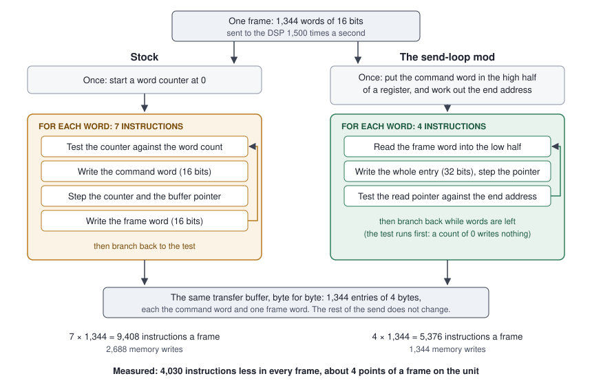

# The send loop

`sendloop` makes the instrument's main processor spend less time on each audio frame. The user sees and hears no difference. The mod gives more room before a busy pattern makes the audio interrupt run late.

## What it does

The Digitone II has two processors. The ColdFire runs the sequencer, the screen and the keys. The SHARC DSP makes the sound. 1,500 times a second, an audio interrupt on the ColdFire sends one frame of 1,344 words to the DSP. The frame holds the values of every track.

Before the transfer, the send routine copies the frame into a transfer buffer. Each 16-bit frame word goes into the buffer beside a fixed 16-bit command word. So one frame word becomes one entry of 4 bytes.

The mod replaces the loop that makes this copy. The new loop is the same size, so nothing else in the firmware moves. It writes the same bytes into the same buffer.



## Why the new loop is shorter

Stock handles each entry in two parts. It writes the command word, then the frame word, and it keeps a counter of the words. That is 7 instructions and two memory writes for each word.

The new loop does three things in a different way:

- **The command word is prepared once.** It goes into the high half of a 32-bit register before the loop. The loop then reads each frame word into the low half of the same register. The register now holds one complete entry.
- **One write for each entry.** The loop stores the register with one 32-bit write. The write also moves the buffer pointer to the next entry.
- **An end address in place of a counter.** The loop stops when the read pointer reaches the end of the frame words. So it does not count.

That is 4 instructions and one memory write for each word.

| | Stock | The mod |
|---|---|---|
| Instructions for each word | 7 | 4 |
| Instructions for a frame of 1,344 words | 9,408 | 5,376 |
| Memory writes for a frame | 2,688 | 1,344 |
| Size of the loop | 24 bytes | 24 bytes |

## Our code

This is the mod's loop, as the ColdFire runs it. It is our own code. `src/dnfw/mods/sendloop.py` holds the same 24 bytes.

When the loop starts, `%a3` points to the frame words, `%a0` points to the transfer buffer and `%d0` holds the number of bytes to send.

```asm
        movea.l %a0,%a1             | keep the buffer's start: the code after the loop needs it
        asr.l   #1,%d0              | the byte count becomes the word count
        move.l  #0x80010000,%d2     | the command word in the high half of %d2, once
        lea     (%a3,%d0.l*2),%a2   | %a2 = the end of the frame words
        bra.s   2f                  | test first: a count of 0 writes nothing
1:      move.w  (%a3)+,%d2          | the next frame word, into the low half of %d2
        move.l  %d2,(%a0)+          | one 32-bit write: the command word and the frame word
2:      cmpa.l  %a3,%a2             | are there words left?
        bhi.s   1b                  | yes: do the next word
```

Notes on the code:

- `move.w (%a3)+,%d2` changes only the low 16 bits of `%d2`. The command word in the high half stays for every entry.
- The loop tests before the first word. A request for 0 bytes writes nothing, as in stock.
- The scale factor in `lea (%a3,%d0.l*2),%a2` is 2. The ColdFire has scale factors 1, 2 and 4. It does not have 8.
- After the loop, `%a0`, `%a1`, `%a3` and `%d0` hold the same values as after stock's loop. The code that follows reads them.
- `%a2` and `%d2` hold other values than after stock's loop. The routine does not read them again. It saved both on entry and restores both on return.

## Where it applies

- One edit of 24 bytes in MAIN OS: `0x400cf912` on OS 1.11 and `0x400cfa76` on OS 1.12. Nothing is appended.
- The mod checks that stock's 24 bytes are at that place before it writes. On each OS, those bytes occur one time in the image.
- The send routine has three callers. All of them ask for the full frame of 0xa80 bytes.

## Evidence

| Check | Result |
|---|---|
| Emulator, 7 scenarios against a control build | 4,030 instructions less in every frame. No scenario is worse |
| The transfer buffer | The same contents as stock |
| The real DSP code in the emulator | The rendered samples are equal to stock's, sample for sample |
| The unit, stopped | The audio interrupt uses 47.6 % of a frame. The control uses 51.4 % |
| The unit, the factory pattern DARKWAX24 B05 at 155 BPM | 46.1 % against 50.0 %. The worst frame is 91.7 % against 95.6 % |
| The unit, interrupts longer than a frame | 0 on both builds |
| Recordings of both builds | Level within 0.02 dB, spectrum within 0.36 dB, no timing drift |

The unit test was made on OS 1.11 on 2026-11-15. No unit has run the OS 1.12 build.

## How to build with it

```
dnfw mods apply Digitone_II_OS1.11.syx --mod sendloop -o out.syx
```

`sendloop` combines with every other mod that does not write the same 24 bytes. `dnfw mods apply` checks that.
